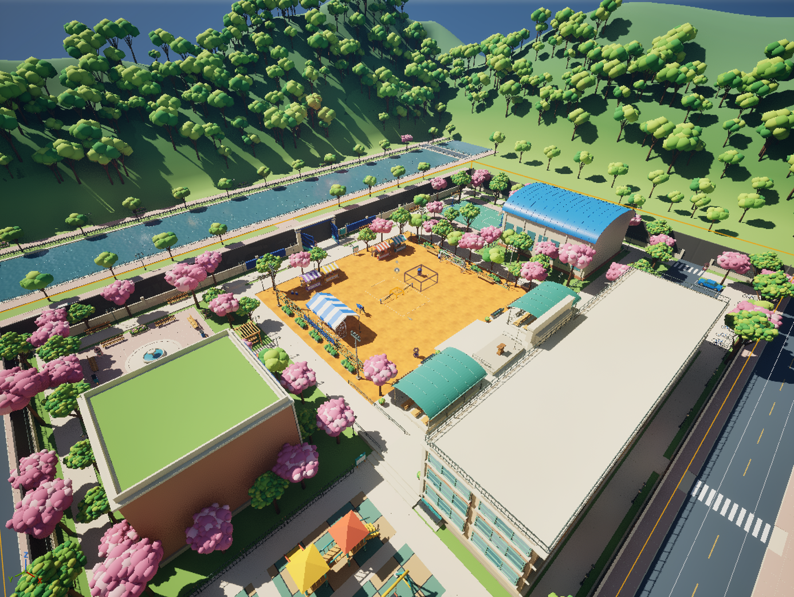
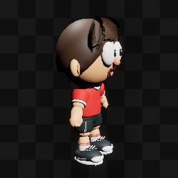
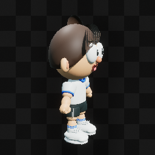
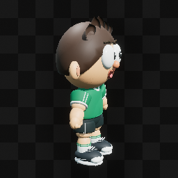
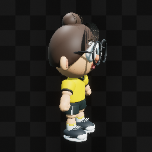
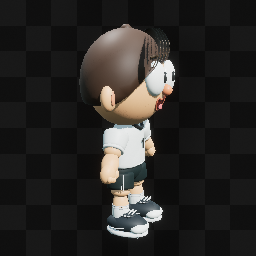
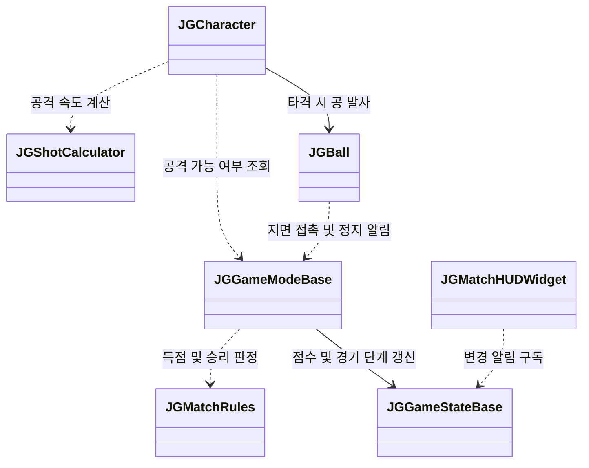
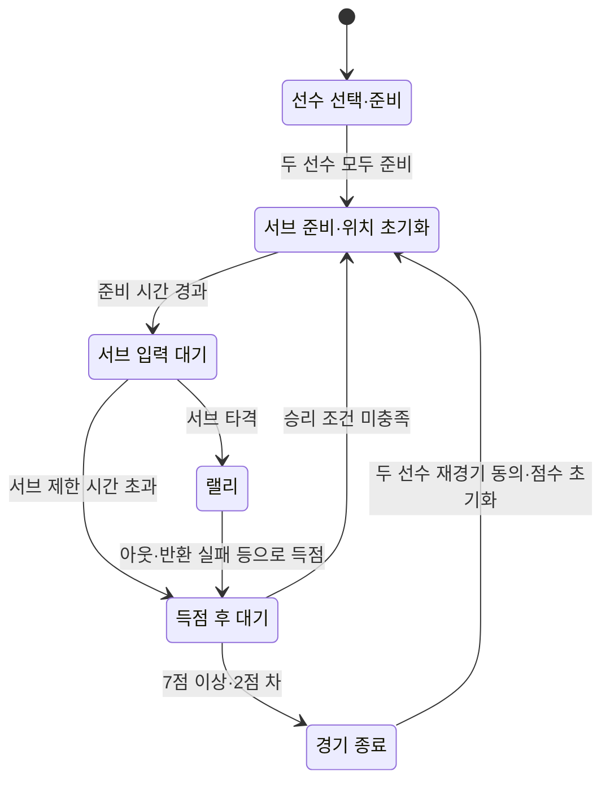

> **게임 다운로드 (Google Drive): 링크 등록 예정**
>
> Windows 개발 빌드를 이곳에 공개할 예정입니다. 현재 다운로드 링크는 등록되어 있지 않습니다.

<!-- DOWNLOAD_LINK: 배포 파일을 업로드하면 위 안내를 실제 Google Drive 다운로드 링크로 교체합니다.
함께 기재할 정보: 빌드 버전 / 업로드 날짜 / 대상 플랫폼 / 변경 사항.
-->

# 족구하세요 · DoJokgu

학교 운동장에서 두 사람이 공을 주고받는 **1:1 족구 게임**입니다. 탭으로 짧게 넘기고, 드래그 방향과 길이로 공격 방향·파워를 조절하며, 슬라이딩으로 수비합니다.

현재 **Windows LAN 프로토타입을 개발 중**입니다. 경기 규칙과 조작, 학교 로비, 선수 선택, 방 생성·검색·참가를 구현했으며, 실제 두 기기에서의 경기 검증과 모바일 확장이 남아 있습니다.

| 항목 | 현재 기준 |
| --- | --- |
| 엔진 | Unreal Engine 5.8 (`DoJokgu.uproject` 기준) |
| 구현 | C++ · Blueprint · UMG · Enhanced Input |
| 경기 방식 | 1:1, 플레이어 한 명이 서버를 겸하는 Listen Server |
| 접속 방식 | OnlineSubsystemNull 기반 LAN |
| 패키징 | Windows 64비트 Development 빌드 생성 확인 |
| 문서 기준일 | 2026-10-17 |

## 화면 미리보기



*`L_Campus_Lobby`의 개발 중 전경. 2026-10-17 Unreal MCP로 캡처한 에디터 화면이며, 일부 편집용 표시가 포함되어 있습니다.*

<!-- MEDIA_NEXT: 실제 경기 검증 후 이곳에 랠리·슬라이딩·득점 화면 또는 플레이 영상을 추가합니다.
이미지는 Docs/images/readme/에 저장하고 상대 경로로 연결합니다.
캡션에는 화면의 내용, 촬영한 빌드와 날짜를 적습니다.
-->

## 현재 구현된 기능

아래는 코드와 에셋이 연결된 범위입니다. 실제 플레이까지 확인한 범위는 [검증 현황](#검증-현황)에 별도로 기록합니다.

| 구분 | 구현 내용 |
| --- | --- |
| 경기 진행 | 선수 선택·준비 → 서브 → 랠리 → 득점 → 경기 종료·재경기 흐름, 점수·단계·결과 HUD |
| 공격과 수비 | 탭 공격, 드래그 각도·연속 파워, 약·중·강 공격 모션, 슬라이딩과 회복 시간 |
| 서버 판정 | 타격 거리·높이·차례 검사, 150ms 공격 입력 저장, 바운드·아웃·득점 판정, 라운드당 중복 득점 방지 |
| LAN 접속 | 방 만들기, 방 목록 검색·새로고침·참가, 로비 복귀, 접속 실패 시 세션 정리와 사유 표시 |
| 학교 로비 | 이동·점프·카메라 회전, Play·Settings 구역과 바로가기, 돌아다니는 학생 NPC |
| 캐릭터 | 선수 5명 선택·준비, 마지막 선택 저장, 공통 리그 기반 이동·킥·서브·슬라이딩 애니메이션 연결 |
| 배경 | 학교·운동장·족구 코트, 관중 애니메이션, 도로를 순환하는 차량, 흐르는 강 표현 |
| 설정 | 그래픽 품질, 전체·효과음·배경음 볼륨 설정과 저장. 실제 소리 에셋 연결은 후속 작업 |

### 경기 규칙

현재 프로토타입에 구현한 게임 규칙이며, 정식 족구 규격을 그대로 재현한 규칙은 아닙니다.

- **승리:** 7점 이상이면서 2점 차로 앞서면 승리합니다. 6:6 이후 7:6은 계속하고, 8:6이면 끝납니다.
- **서브:** 첫 서브는 서버가 무작위로 정하고, 이후에는 득점자가 서브합니다. 준비 시간 1.5초 후 입력할 수 있으며, 10초 안에 서브하지 않으면 실점합니다.
- **반환:** 바운드 전에 받아칠 수 있으며, 받는 쪽 코트에서 한 번 튀는 것까지 허용합니다. 자신이 친 공을 연속으로 칠 수는 없습니다.
- **아웃·실점:** 첫 착지가 코트 밖이거나 자기 코트이면 친 사람이 실점합니다. 상대 코트에 한 번 들어간 공을 반환하지 못하면 두 번째 지면 접촉 위치와 관계없이 받는 사람이 실점합니다.
- **라인·네트:** 라인 위 착지는 인입니다. 네트 접촉 자체로 득점하지 않으며, 이후 착지·정지 결과로 판정합니다.

### 선택 가능한 선수

| 김도윤 | 이민지 | 최태성 | 고윤서 | 한재민 |
| :---: | :---: | :---: | :---: | :---: |
|  |  |  |  |  |

Unreal MCP로 추출한 캐릭터 에셋 미리보기입니다. 선수 목록은 `DA_JGCharacterRoster` 한 곳에서 관리합니다. 현재 이동 속도·킥 파워·정확도·리치 능력치는 모두 임시값 **3**이며, 선수별 능력치 차등화는 아직 적용하지 않았습니다.

<!-- FEATURE_NEXT: 기능이 완료되면 위 표에 구현한 동작을 추가하고, 아래 검증 현황에도 확인 환경·결과를 함께 기록합니다.
선수별 능력치가 확정되면 이 아래에 역할·능력치 표를 추가합니다.
-->

## 실행과 조작

### Windows 개발 빌드

다운로드 링크가 공개되면 다음 순서로 실행합니다.

1. 페이지 맨 위 Google Drive에서 빌드를 받아 **압축 파일 전체**를 풉니다.
2. 패키지 폴더 안의 `DoJokgu.exe`를 실행합니다. 실행 파일만 따로 옮기지 않습니다.
3. 두 플레이어가 같은 LAN에 연결하고, 두 PC 모두 Windows 방화벽에서 게임의 통신을 허용합니다.
4. 한 명은 로비의 **Play → Create room**으로 방을 만듭니다. 다른 한 명은 **Play → Refresh**로 방을 찾아 참가합니다.
5. 양쪽이 선수를 선택하고 **Ready**를 누르면 경기가 시작됩니다. 결과 화면에서 **Rematch**로 재경기를 요청하거나 **Lobby**로 돌아갑니다.

현재 접속은 LAN 기준입니다. 서로 다른 인터넷 네트워크 간 대전은 아직 지원하지 않습니다. 위 절차의 **PC 두 대 실제 경기·재경기는 검증 예정**입니다.

### PC 조작

| 상황 | 동작 | 입력 |
| --- | --- | --- |
| 공통 | 이동 | `WASD` / 방향키 |
| 로비 | 카메라 회전 | 마우스 오른쪽 버튼 드래그 |
| 로비 | 점프 | `Space` 또는 `J` |
| 로비 | 경기·설정 열기 | Play·Settings 버튼 또는 해당 구역에 들어가 표시되는 버튼 |
| 경기 | 탭 공격 | 화면 오른쪽 영역 짧게 클릭 또는 `J` |
| 경기 | 드래그 공격 | 화면 오른쪽 영역을 끌었다 놓기. `K`는 정면·50% 파워 테스트 입력 |
| 경기 | 슬라이딩 | `Space` 또는 SLIDE 버튼 |
| 경기 종료 | 재경기 요청 | `R` 또는 Rematch 버튼 |

`Space`와 `J`는 로비와 경기에서 서로 다른 동작에 사용됩니다.

모바일용 왼쪽 조이스틱, 오른쪽 탭·드래그 공격, SLIDE 버튼과 로비 카메라 드래그도 구현되어 있습니다. Android·iOS 패키징과 실기기 조작 검증은 아직 진행하지 않았으며, 로비 점프 터치 버튼은 추가 예정입니다.

## 기술 구성

### 주요 클래스 관계

경기 처리에 사용하는 핵심 클래스의 호출·참조 관계입니다. 클래스 이름은 소스의 `A`·`U` 접두사를 생략했습니다.



| 클래스 | 맡는 일 |
| --- | --- |
| [JGCharacter](Source/DoJokgu/Jokgu/Player/JGCharacter.h) | 이동·공격·슬라이딩 입력 처리. 공격 종류·각도·파워를 서버에 요청하고, 서버에서 거리·높이·받을 차례를 검사한 뒤 공 발사 |
| [JGShotCalculator](Source/DoJokgu/Jokgu/Gameplay/JGShotCalculator.h) | 탭·드래그·슬라이딩에 따른 공의 초기 속도 계산과 공격 모션 선택 |
| [JGBall](Source/DoJokgu/Jokgu/Gameplay/JGBall.h) | 공 이동·충돌·바운드 처리, 마지막 타격 팀·받을 팀·바운드 횟수 보관, 지면 접촉·정지 이벤트 전달 |
| [JGGameModeBase](Source/DoJokgu/Jokgu/Core/JGGameModeBase.h) | 서버에서 경기 시작·서브·득점·종료·재경기 처리. 판정 결과에 따라 점수와 다음 서브 팀 결정 |
| [JGMatchRules](Source/DoJokgu/Jokgu/Core/JGMatchRules.h) | 코트 경계, 지면 접촉에 따른 득점자, 듀스·승리 조건 등을 독립된 함수로 판정 |
| [JGGameStateBase](Source/DoJokgu/Jokgu/Core/JGGameStateBase.h) | 양쪽 점수·경기 단계·서브 팀·라운드·단계 종료 시각을 `FJGMatchSnapshot`에 보관하고 클라이언트에 복제 |
| [JGMatchHUDWidget](Source/DoJokgu/Jokgu/UI/JGMatchHUDWidget.h) | 경기 정보의 변경 알림을 구독해 점수·남은 시간·결과와 버튼 표시 갱신 |

`JGGameStateBase`는 서버에서 값이 바뀌면 직접, 클라이언트에서는 `OnRep_Match`가 호출되면 `OnMatchStateChanged`를 알립니다. 양쪽 HUD는 이 알림을 통해 같은 항목을 갱신합니다. 선수별 팀·선택 캐릭터·준비 여부는 `JGPlayerState`가 별도로 보관·복제합니다.

공은 `ProjectileMovement`와 전용 충돌 채널을 사용합니다. 클라이언트에서는 보이는 공 메시를 서버 위치로 부드럽게 따라가게 하는 보간을 구현했으며, 지연 환경에서의 체감 검증은 남아 있습니다. 경기 수치는 `DA_Balance_Default`, 선수 목록은 `DA_JGCharacterRoster`에서 조정합니다.

### 경기 단계 전환

점수로 승패를 결정하는 일반 2인 경기의 흐름입니다. 각 단계는 [JGTypes.h의 `EJGMatchPhase`](Source/DoJokgu/Jokgu/Core/JGTypes.h)에 정의되어 있으며, 서버의 `JGGameModeBase`가 전환합니다.



득점 후에는 득점자가 다음 서브를 맡습니다. 상대가 중도 이탈해 종료된 경기는 재경기 투표 대신 새 상대를 기다립니다.

### 저장소 구조

```text
DoJokgu.uproject
Source/DoJokgu/Jokgu/
├── Core/          # 경기 진행·규칙·점수 복제·설정 저장
├── Player/        # 경기 캐릭터·입력·이동 제한·애니메이션
├── Gameplay/      # 공·코트·공 궤적 계산·연습용 발사기
├── Lobby/         # 로비 캐릭터·상호작용 구역·학생 NPC
├── Online/        # LAN 세션 생성·검색·참가·정리
├── UI/            # HUD·선수 선택·터치 조작·설정 패널
├── Data/          # 밸런스·선수 목록·캐릭터 데이터
├── Environment/   # 배경 차량 이동
└── Tests/         # 경기 규칙·샷 계산 자동화 테스트
Config/            # 기본 맵·온라인 설정·패키징 설정
Tools/             # 캠퍼스 구성·캐릭터 연결·로비 설정 스크립트
Docs/              # 개발 문서·README 이미지
```

### 소스에서 프로젝트 열기

**이 저장소에는 `Content/`, `Art/`, `.uasset`, `.umap`이 포함되지 않습니다.** [.gitignore](.gitignore)에서 제외하고 있으므로, Git 저장소를 복제하는 것만으로는 게임 맵과 캐릭터를 실행할 수 없습니다. 위의 게임 다운로드는 실행용 패키지이며, 에디터 작업에는 별도의 원본 에셋이 필요합니다.

1. 프로젝트와 호환되는 Unreal Engine 5.8 및 Unreal C++ 빌드 환경을 준비합니다.
2. 별도로 확보한 프로젝트 에셋을 원래 `Content/` 경로에 배치합니다. 아트 도구를 다시 실행하려면 해당 도구가 요구하는 원본 파일도 필요합니다.
3. `.uproject`에 활성화된 플러그인을 준비합니다. 현재 `ModelContextProtocol`, `AllToolsets`와 OnlineSubsystem 관련 플러그인이 설정되어 있습니다.
4. 프로젝트 파일을 생성한 뒤 `DoJokguEditor`의 `Development Editor / Win64` 구성을 빌드하고 `DoJokgu.uproject`를 엽니다.
5. 로비는 `/Game/Jokgu/Maps/L_Campus_Lobby`, 경기는 `/Game/Jokgu/Maps/L_Campus_Match`를 엽니다.

<!-- SETUP_NEXT: 원본 에셋 제공 방식을 결정하면 이곳에 접근 방법·버전·복원 절차를 추가합니다.
배포용 실행 파일과 에디터용 원본 에셋을 구분해서 안내합니다.
-->

## 검증 현황

기존 [프로토타입 작업 현황](Docs/프로토타입_작업현황.md)과 테스트 기록을 바탕으로 정리했습니다. 아래의 통과 기록은 각 날짜의 결과이며, 모든 환경의 플레이 완료를 뜻하지 않습니다.

| 확인일 | 항목 | 확인한 범위 |
| --- | --- | --- |
| 2026-10-12 | 자동화 테스트 6개 | 듀스, 코트 경계, 지면 접촉, 네트 통과 기록, 준비 단계, 샷 계산 통과 |
| 2026-10-14 | 캠퍼스 보행·환경 | 사용자 PIE 보행 확인. 차량 이동 등 환경 연출 확인 |
| 2026-10-15 | Windows 패키지 | Win64 Development 패키징·실행 확인 |
| 2026-10-15 | LAN 접속 | **한 PC의 패키지 창 3개**로 방 생성 → 검색 → 참가 → 경기 맵 진입, 만원 방의 검색 제외 확인 |

자동화 테스트는 에디터의 **Session Frontend → Automation**에서 `Jokgu`로 필터링해 실행할 수 있습니다. 테스트 코드는 [JGMatchRulesTests.cpp](Source/DoJokgu/Jokgu/Tests/JGMatchRulesTests.cpp)에 있습니다.

남은 확인 범위는 **PC 두 대의 실제 입력 경기·재경기**, 공격 애니메이션과 공 접촉 시점, 약 100ms 왕복 지연에서의 공 표시·타격 판정, 모바일 실기기 성능입니다. 소리 에셋은 아직 연결되어 있지 않으며, 최소·권장 사양도 실측 후 기재할 예정입니다.

<!-- VALIDATION_NEXT: 새 검증 결과는 위 표에 날짜 / 빌드 / 기기·네트워크 / 확인 범위를 기록합니다.
구현 설명에는 완료한 기능을 추가하고, 확인하지 않은 조건은 검증 현황에 남겨 둡니다.
-->

## 관련 문서

- [프로토타입 작업 현황](Docs/프로토타입_작업현황.md): 구현 상세, 검증 기록, 남은 작업
- [개발 준비 계획서](Docs/족구하세요_개발준비계획서.md): 규칙·설계 방향과 단계별 계획. 계획 항목은 완료 기능과 구분해서 참고
- [캠퍼스·로비 설계](Docs/superpowers/specs/2026-10-08-campus-lobby-design.md): 로비와 경기 맵의 구성 의도
- [캠퍼스 도구 사용법](Tools/Campus/README.md): 배경 구성·재생성 스크립트 사용법

## 크레딧·라이선스

코드와 아트·사운드·외부 리소스의 배포 조건을 정리한 뒤 기재할 예정입니다. 현재 저장소에는 별도의 `LICENSE` 파일이 없습니다.

<!-- CREDITS_NEXT: 개발자·기여자, 리소스별 제작자와 출처, 라이선스 및 수정 여부를 확인한 뒤 추가합니다.
문의·피드백 연락처가 정해지면 이 아래에 공개 가능한 연락처를 추가합니다.
-->
